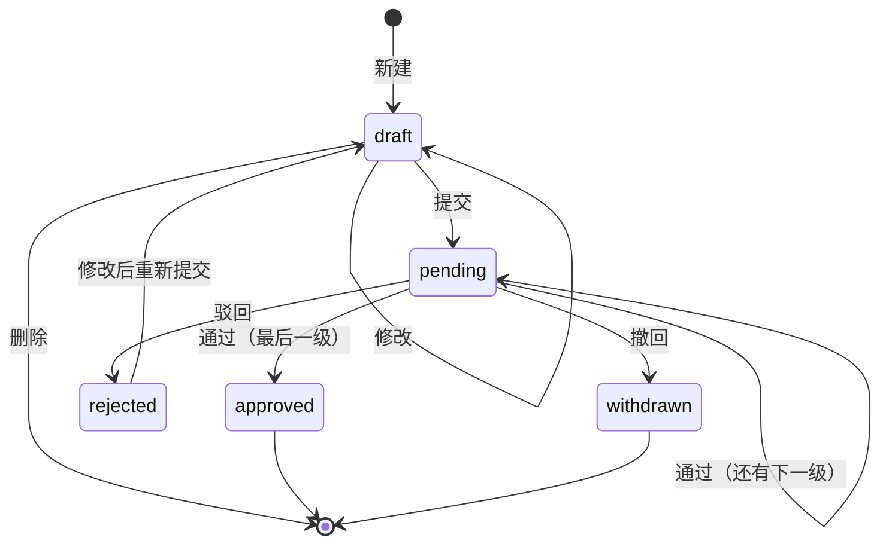

# 需求说明

## 1. 系统做什么

公司内部的审批系统。员工在线提交请假和报销申请，按规定的顺序一级一级审批，申请人随时能看到自己的单子走到哪一步、谁审的、审批意见是什么。

本学期只做两种单据：

- 请假：一级审批，部门经理审。
- 报销：两级审批，先部门经理，再财务。

## 2. 用户和角色

| 角色 | 说明 |
|---|---|
| 普通员工 `staff` | 提交、查看、撤回自己的申请 |
| 财务 `finance` | 普通员工能做的都能做；另外审批报销单的第二级 |
| 管理员 `admin` | 管理部门和用户；可以代审任何一级 |

部门经理不是单独的角色。每个部门在部门表里指定一个经理（`departments.manager_id`），这个人审批本部门的第一级。这样换经理只改一处，不用同时改用户的角色。

每个用户属于一个部门；管理员可以不属于任何部门，不属于部门的管理员不能提交申请。

## 3. 业务流程

### 3.1 单据状态

| 状态 | 含义 |
|---|---|
| `draft` 草稿 | 已保存，还没提交，只有申请人自己看得到 |
| `pending` 审批中 | 已提交，等第 `current_step` 级审批 |
| `approved` 已通过 | 最后一级审批通过 |
| `rejected` 已驳回 | 任何一级驳回 |
| `withdrawn` 已撤回 | 申请人在审批完成前撤回 |

图里没有画出来的变化一律不允许，例如已通过的单子不能再驳回，草稿不能直接审批。服务端收到不允许的操作直接拒绝，不改数据。

### 3.2 每一步谁来做

| 操作 | 谁能做 | 前提 |
|---|---|---|
| 新建、修改、删除草稿 | 申请人本人 | 状态是 `draft` |
| 提交 | 申请人本人 | 状态是 `draft`，内容校验通过 |
| 撤回 | 申请人本人 | 状态是 `pending` |
| 第 1 级通过 / 驳回 | 申请人所在部门的经理，或管理员 | 状态是 `pending`，`current_step = 1` |
| 第 2 级通过 / 驳回（报销） | 财务，或管理员 | 状态是 `pending`，`current_step = 2` |
| 重新编辑被驳回的单子 | 申请人本人 | 状态是 `rejected` |
| 查看单据详情 | 申请人本人；提交过的单子，还有所在部门的经理、管理员，报销单再加上财务 | 草稿只有申请人本人能看 |
| 管理部门和用户 | 管理员 | 无 |

另外两条规则：

- 任何一级的审批人都不能是申请人本人。部门经理自己请假，第 1 级由管理员审；财务自己报销，第 2 级由其他财务或管理员审。
- 驳回必须填写理由，通过可以不填。

### 3.3 提交时确定走几级

提交时按单据类型确定总级数，记在单子上（`total_steps`）：请假 1 级，报销 2 级。审批中途就算规则改了，已提交的单子也按提交时的级数走完。

被驳回的单子重新编辑后，审批从第 1 级重新开始，轮次 `round` 加 1。之前几轮的审批记录保留，详情页能看到全部历史。

### 3.4 管理部门和用户

管理员可以：

- 新建部门、改部门名，部门名不能重复；给部门指定经理或取消经理。
- 新建用户：账号（3~32 位小写字母、数字或下划线，建好后不能改）、姓名、角色、部门、初始密码（至少 6 个字符）。
- 修改用户的姓名、角色和部门；停用、启用用户；重置密码。

规则：

- 部门经理必须是本部门在职的人。新部门还没有人，先建部门、把人调进来，再指定经理。
- 部门经理不能调到别的部门，也不能停用，要先给部门换经理。否则原部门的第 1 级就没人审了。
- 部门没有经理时，第 1 级只有管理员能审。
- 换经理后，这个部门停在第 1 级的单子改由新经理审，因为审批人是审批时按部门表查的。
- 管理员不能停用自己，也不能取消自己的管理员身份，保证系统里总有一个能用的管理员。
- 停用只做标记，不删除用户，审批记录里仍显示这个人的名字。停用的账号不能登录，已登录的立即失效。
- 重置密码后，这个用户已登录的地方都要用新密码重新登录。
- 调部门、改角色不影响已经提交的单子：单子记的是提交时的部门。

## 4. 单据内容与校验

所有单据都有：标题（1~100 字）。

请假：

- 类型：年假、病假、事假
- 开始日期、结束日期，结束不早于开始
- 天数：大于 0，以 0.5 天为单位，不超过起止日期跨的天数
- 事由：1~500 字

报销：

- 类别：差旅、办公用品、招待、其他
- 金额：大于 0，最多两位小数，单笔不超过 100000 元
- 事由：1~500 字

校验在前端和后端各做一遍。前端校验是为了让用户马上看到哪里填错；后端校验才算数，绕过页面直接调接口也过不去。数据库再用约束兜底（见 `db/schema.sql`）。

## 5. 出错时怎么处理

| 情况 | 返回 | 页面上的表现 |
|---|---|---|
| 输入不合法 | 422，带出错的字段 | 对应输入框下面显示原因 |
| 没登录或登录过期 | 401 | 跳到登录页，登录后回到原来的页面 |
| 登录了但没有权限 | 403 | 提示“没有权限”，不暴露单据内容 |
| 单据不存在 | 404 | 提示单据不存在 |
| 状态不允许这个操作，或单子已经被别人改过 | 409 | 提示“单据状态已变化”，并刷新成最新状态 |

### 重复操作

- 重复提交表单（网络慢时连点、刷新后重发）：新建单据时前端生成一个随机的 `client_key` 一起发上来，数据库里同一个人的 `client_key` 唯一，重复请求返回第一次建好的那张单，不会多出一条。
- 重复审批、两人同时审批同一张单：每张单有版本号 `version`，每次修改加 1。审批请求带上页面看到的版本号，更新时 `WHERE version = 看到的版本号`，没更新到任何行就说明单子已经被别人改过，返回 409。审批记录表里同一轮同一级只能有一条（唯一约束），作为最后一道防线。

## 6. 页面

- 登录页
- 我的申请：列表，按状态筛选
- 新建 / 编辑申请
- 待我审批：列表
- 单据详情：内容、当前状态、审批历史，以及当前用户能做的操作按钮
- 管理（只有管理员看得到）：部门、用户

## 7. 不做的

- 注册：账号由管理员建。
- 自定义审批流程：级数和审批人按第 3 节的规则写死。
- 附件上传、发票识别。
- 消息通知（邮件、短信）：登录后在“待我审批”里看。
- 加签、转审、会签。
- 多公司、多语言。
